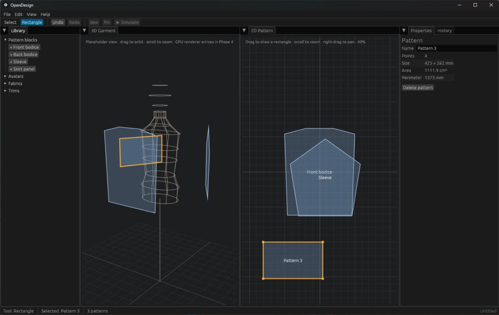

# OpenDesign

Open-source 3D garment design: draw flat patterns in 2D, sew them, and drape
them on an avatar in 3D.

This is the starter app shell (Phases 1–2 of the roadmap): docked panels,
a 2D pattern canvas, a placeholder 3D view, and undo/redo for every change.



## Run

```bash
cargo run -p od_app
```

The binary is called `opendesign`. Release build: `cargo build --release`.

### Windows without Visual Studio

This machine builds with Rust's GNU toolchain (`stable-x86_64-pc-windows-gnu`),
which needs MinGW's `dlltool` and `as`. MSYS2's UCRT64 tools provide them, so
put them on PATH for the build (the finished `.exe` does not need them):

```powershell
$env:Path = "C:\msys64\ucrt64\bin;$env:Path"
cargo run -p od_app
```

With Visual Studio Build Tools installed, the default MSVC toolchain works
without this step.

## Use

| Action | How |
|---|---|
| New / Open / Save / Save As | `Ctrl+N` / `Ctrl+O` / `Ctrl+S` / `Ctrl+Shift+S`, or File menu |
| Reopen a recent project | File → Open Recent, or drag an `.odproj` onto the window |
| Quit | `Ctrl+Q` (asks first if there are unsaved changes) |
| Add a starter block | Library → `+ Front bodice` etc. |
| Draw a rectangle pattern | Rectangle tool (`R`), drag in the 2D window |
| Select / move | Select tool (`V`), click or drag a pattern |
| Delete | `Del`, or the button in Properties |
| Undo / redo | `Ctrl+Z` / `Ctrl+Y` (or `Ctrl+Shift+Z`) |
| Pan / zoom 2D | Right-drag / scroll |
| Orbit / pan / zoom 3D | Drag / right- or middle-drag / scroll; double-click or Frame to fit everything |
| 3D camera presets | Front, Back, Left, Right, Top buttons above the 3D view |
| Select a pattern in 3D | Click it (the avatar blocks patterns behind it) |
| Change avatar | Library -> Avatars: Female, Male, Kid, or Load avatar file (OBJ/glTF, Y up) |
| Avatar size | Avatar size button in the 3D view: height, chest, waist, hip |
| Rearrange panels | Drag a tab to another panel edge |
| Reset panels, theme | View menu |

Panel layout and theme are remembered between sessions (eframe stores them in
`%APPDATA%\OpenDesign\data\app.ron` on Windows). View → Reset layout restores
the default arrangement.

### Project files

Projects are saved as `.odproj`: versioned JSON
(`{"format": "opendesign-project", "version": 1, "document": {...}}`).
Saves go through a temporary file and a rename, so a crash mid-save never
leaves a half-written project. The title bar shows `*` and the status bar
says "Unsaved changes" until you save; New, Open, Quit and closing the window
ask before discarding them.

### Smart App Control

If Windows Smart App Control is on, it blocks freshly built, unsigned programs
("An Application Control policy has blocked this file"). That includes
`opendesign.exe` and the build scripts Cargo compiles, so native Windows builds
fail. Building in WSL still works (`cargo test --workspace`), and
`cargo check --target x86_64-pc-windows-gnu` there type-checks the Windows
build. Code-signing the binary is the long-term fix for releases.

## Layout

```
crates/
  od_core/   Document model, commands, undo/redo history, 2D geometry,
             project file format (project.rs). No UI.
  od_app/    egui + egui_dock desktop app.
    src/app.rs           Shell: menus, toolbar, status bar, dock layout, UI tests
    src/files.rs         Open/save, recent files, unsaved-changes prompt
    src/panels/          One module per dockable tab
    src/theme.rs         Design tokens (light/dark) for widgets and canvases
```

Every edit is a `Command` (`apply` + `undo`) run through `History`, so a new
tool gets undo/redo by adding one command type in `od_core`.

## Test

```bash
cargo test --workspace
```

`od_app` tests use `egui_kittest` to click and type through the real UI
without opening a window.

## Roadmap

1. App shell ✅ docked panels, menus, toolbar, status bar, token-based
   light/dark theme, layout and theme remembered between sessions
2. Core and save/load ✅ commands and undo, `.odproj` files, unsaved-changes
   tracking and prompts, recent files, drag-and-drop open
3. 2D pattern editor: points, curves, notches, seam allowance
4. 3D viewport ✅ wgpu renderer (lit, depth-tested, floor grid, contact
   shadow), orbit camera with presets, procedural sized avatars, OBJ/glTF
   avatar loading, patterns placed around the avatar, click-to-select in 3D
5. Sewing
6. Cloth simulation
7. Fabrics and materials
8. Asset library
9. Import/export (OBJ, glTF, DXF-AAMA)
10. Grading, measurements, trims, rendering
11. Python plugins (pyo3), localisation, installer
